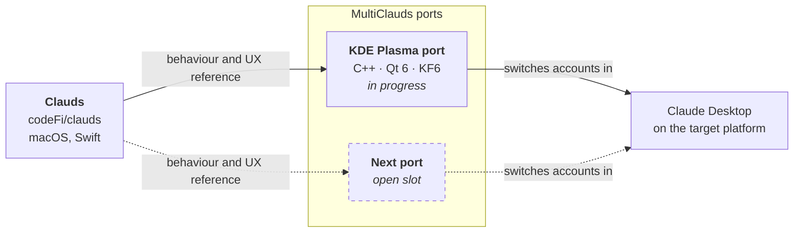

# MultiClauds

**Platform ports of [Clauds](https://github.com/codeFi/clauds), the native app for switching between multiple Claude Desktop accounts.**

Clauds was created by [codeFi](https://github.com/codeFi) as a macOS menu bar app. MultiClauds is a home for ports that bring the same idea to other desktops, each written natively for its platform instead of sharing one cross-platform UI.

> [!NOTE]
> MultiClauds is a community effort. It is not affiliated with or endorsed by Anthropic or by the upstream Clauds project. "Claude" is a trademark of Anthropic.

## Ports

| Platform | Stack | Status | Source |
|---|---|---|---|
| macOS | Swift (upstream original) | Maintained upstream | [codeFi/clauds](https://github.com/codeFi/clauds) |
| KDE Plasma 6 (Linux) | C++, Qt 6, KDE Frameworks 6 | In progress, draft PR | [atterdag/clauds#1](https://github.com/atterdag/clauds/pull/1), code under `kde/` |
| *Your platform* | | | See [Adding a port](#adding-a-port) |

## How the ports relate



Upstream defines what the app does. Each port decides how to do it on its own platform, using that platform's toolkit, packaging, and conventions.

## KDE Plasma port

| | |
|---|---|
| **Stack** | C++, Qt 6, KDE Frameworks 6 |
| **Location** | `kde/` in the [atterdag/clauds](https://github.com/atterdag/clauds) fork, branch `claude/project-thread-bujydl` |
| **Status** | Draft pull request [#1](https://github.com/atterdag/clauds/pull/1) |
| **Build** | Makefile wrapper around CMake |

```sh
make            # compile the app and the tests
make test       # run the test suites
make deb        # build the .deb package
make help       # list all targets
```

The port lives in its own `kde/` folder so the upstream Swift code stays untouched and mergeable. See `kde/README.md` in the fork for dependencies and details.

## Adding a port

A port is welcome when it follows these principles.

| Principle | What it means |
|---|---|
| **Native** | Use the platform's own toolkit and conventions. Respect the system theme. |
| **Faithful** | Match upstream behaviour first. Diverge only where the platform requires it, and document why. |
| **Isolated** | Keep the port in its own folder or repository so upstream stays mergeable. |
| **Tested** | Keep account-switching logic in a UI-independent core with unit tests. |
| **Packaged** | Ship in the platform's native format (`.deb`, Flatpak, MSI, and so on). |

Steps:

1. Open an issue or discussion naming the platform and the stack you intend to use.
2. Build the port against the upstream behaviour, in its own folder or repository.
3. Add a README with build, test, and packaging instructions.
4. Add a row to the [Ports](#ports) table above with platform, stack, status, and source link.

## Credits

All credit for the original idea, design, and implementation goes to [codeFi](https://github.com/codeFi) and the [Clauds](https://github.com/codeFi) project. If you use a port, star upstream. Licensing is per repository, so check the license file of the port you use.
